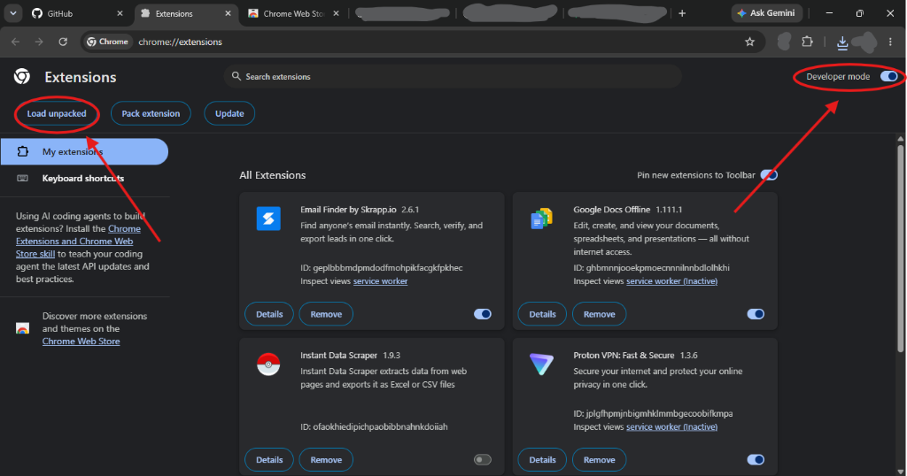

<p align="center">
  
</p>

<h1 align="center">🛡️ SERU GUARD</h1>

<p align="center">
  <strong>Fast, Lightweight, Open-Source & Privacy-First Ad Blocker for Chrome & Chromium Browsers</strong><br>
  <em>Manifest V3 | 18,660+ Declarative Rules | Deep Scriptlet Interception | Zero Telemetry</em>
</p>

<p align="center">
  
  
  
  
</p>

---

## 📌 Introduction / परिचय

**SERU GUARD** ek powerful aur lightweight **open-source Chrome extension** hai jo aapko YouTube ads, popups, cookie consent banners, aur web trackers se completely safe rakhta hai. 

Isme proprietary code ya telemetry ke bina, pure privacy aur maximum speed ke sath banaya gaya hai. Sabhi purane tracking servers aur phone-home calls ko remove kar diya gaya hai taaki aapka browsing data 100% private rahe.

---

## ✨ Key Features (खासियतें)

- 🚫 **18,660+ Declarative Net Request (DNR) Rules**: Native browser-level request filtering jo CPU aur RAM par koi extra load nahi dalta.
- 📺 **Advanced YouTube Ad Skipping**: 
  - `fetch` aur `XHR` responses se `adPlacements` aur `playerResponse.adPlacements` ko JSON-level par prune karta hai.
  - Shorts video ads (`reel_watch_sequence`) ko automatically filter karta hai.
  - Video ad countdown timers ko accelerate karke skip karta hai.
  - **Anti-Bypass Guard (`preventDomBypass`)**: YouTube ya anti-adblock scripts agar hidden `iframe` ke zariye clean `fetch` lene ki koshish karein, toh unhe intercept karta hai.
- 📱 **Facebook & Instagram Sponsored Post Pruning**:
  - GraphQL API responses se `sponsored_data`, `ad_id`, aur `SPONSORED` items ko prune karta hai taaki news feed clean rahe.
- 🎨 **Cosmetic Filtering & Shadow DOM Piercing**:
  - Injects anti-layout-collapse CSS rules (`display: none !important; opacity: 0; width: 0; height: 0;`).
  - Open Shadow DOM nodes ko traverse karke Web Components ke andar chupe ads ko bhi hide karta hai.
- 🛑 **Smart Popunder & Synthetic Click Killer**:
  - Agar koi script programmatically `<a>` tag create karke **50 milliseconds** ke andar simulated click karti hai, toh use instant block karta hai.
- 🔒 **Zero Telemetry (100% Offline & Private)**:
  - Koi tracking, analytics, background heartbeat ya third-party ping nahi hai.

---

## 🚀 How to Install in Chrome (Chrome me kaise lagaye)

Aap SERU GUARD ko bina kisi developer tool ya compiler ke seedha apne browser me load kar sakte hain:

### Step 1: Clone ya Download karein
Is repository ko download ya clone karein:
```bash
git clone https://github.com/your-username/seru-guard.git
```

### Step 2: Chrome Extensions Page kholein
1. Apne Chrome ya Brave browser me jayein.
2. Address bar me type karein:
   ```text
   chrome://extensions
   ```
3. Top-right corner me **"Developer mode"** toggle ko **ON** karein.

### Step 3: "Load unpacked" par click karein
1. Top-left corner par **"Load unpacked"** button par click karein.
2. Is repository ke andar maujood **`extension`** folder (`d:\adblocker\extension`) ko select karein.

<p align="center">
  
</p>

🎉 **Badhai ho! SERU GUARD successfully install ho gaya hai!** Browser ke toolbar me pin karke aap real-time blocked ads aur statistics dekh sakte hain.

---

## 🛠️ How It Works Under the Hood (Kaise Kaam Karta Hai)

```
Webpage / Network Request
        │
        ├──> [1] Declarative Net Request (DNR Engine)
        │         ├── requests.json (7,055 Ad/Tracker rules)
        │         ├── filter1-requests.json (9,506 Malicious rules)
        │         └── cookie-banners-requests.json (2,106 CMP rules)
        │
        ├──> [2] Main World Scriptlet Interception
        │         ├── Proxy(window.fetch) & Proxy(XMLHttpRequest)
        │         ├── JSON Pruning: /player & /graphql
        │         └── preventDomBypass: Protects sandbox iframes
        │
        ├──> [3] DOM Element Hiding (Cosmetic Engine)
        │         ├── Batch CSS style injection into <head>
        │         ├── Piercing open Shadow DOM boundaries
        │         └── Procedural Selectors (:has, :contains, :upward)
        │
        └──> [4] Anti-Popup Hook
                  ├── window.open regex verification
                  └── 50ms synthetic <a> element click interceptor
```

---

## 🎨 How to Customize / Modify for Yourself (Apne Hisab Se Badle)

Aap is project ke code ko asani se customize kar sakte hain:

### 1. Naye Custom Rules Add Karna
- **Network Rules**: [`extension/declarative_net_request/requests.json`](extension/declarative_net_request/requests.json) me naye URL filter rules add kar sakte hain:
  ```json
  {
    "id": 99999,
    "priority": 9999,
    "action": { "type": "block" },
    "condition": {
      "urlFilter": "||example-ads-domain.com^",
      "isUrlFilterCaseSensitive": false
    }
  }
  ```

### 2. YouTube & Social Media Scriptlets Modify Karna
- YouTube filters ke liye: [`extension/content/custom-scripts/youtube/main.js`](extension/content/custom-scripts/youtube/main.js)
- Facebook / Instagram ke liye: [`extension/content/custom-scripts/meta/`](extension/content/custom-scripts/meta/)

### 3. Changes ko Reload Karna
Jab bhi aap kisi file me badlav karein:
1. `chrome://extensions` par jayein.
2. SERU GUARD card ke niche **🔄 (Reload)** icon par click karein. Aapke updates turant live ho jayenge!

---

## 📂 Project Directory Structure

```text
d:\adblocker\
├── extension\                     # Chrome Unpacked Extension Folder (Load this!)
│   ├── manifest.json              # Extension Manifest V3 configuration
│   ├── background.js              # Service worker script imports
│   ├── background\                # Lifecycle, statistics & state management
│   ├── content\                   # Content scripts, DOM filters & scriptlets
│   │   ├── custom-scripts\        # YouTube & Meta MAIN-world scriptlets
│   │   ├── popups-script.js       # Popup & synthetic click interceptor
│   │   └── set-css.js             # Shadow DOM cosmetic style injector
│   ├── declarative_net_request\   # 18,660+ static network blocking rules
│   ├── icons\                     # SERU GUARD shield icons (16, 19, 38, 48, 128, 512)
│   ├── favicon.ico                # Multi-resolution icon
│   └── index.html                 # Extension popup dashboard
├── docs\
│   ├── assets\                    # Logo & branding assets (SVG & PNG)
│   └── screenshots\               # Installation tutorial screenshots
├── LICENSE                        # Official MIT License
└── README.md                      # Documentation & Guide
```

---

## ⚖️ License

This project is licensed under the **[MIT License](LICENSE)**. You are free to use, modify, distribute, and build upon it freely for personal and commercial applications.
